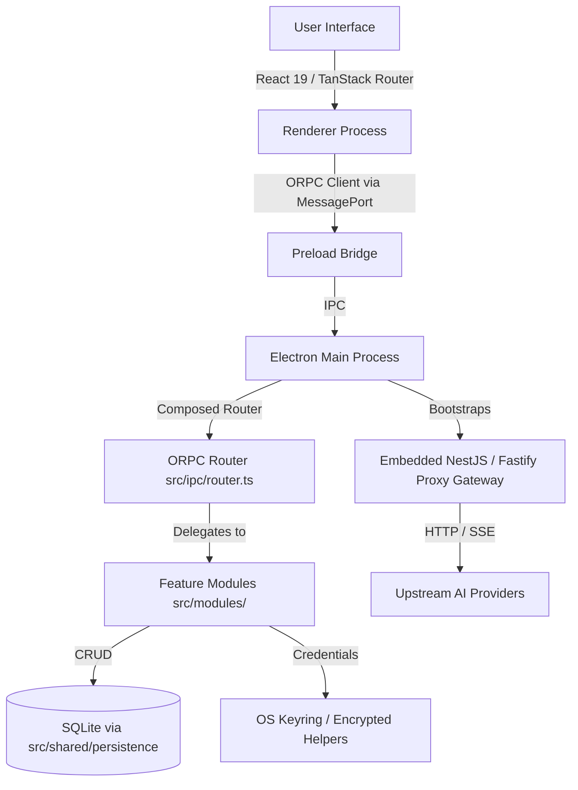

# Antigravity Manager Developer Guide

## 🏗️ Architecture Overview

Antigravity Manager is an Electron desktop application with a React renderer and an embedded NestJS/Fastify proxy gateway. It provides local Antigravity IDE multi-account management, cloud account pools with intelligent auto-switching, and an AI protocol gateway compatible with OpenAI, Anthropic, and Gemini formats.

### Key Technologies

- **Frontend**: React 19, Tailwind CSS v4, TanStack Router, TanStack Query, Radix UI primitives.
- **Backend**: Electron 37+, NestJS + Fastify (Proxy Gateway), Better-SQLite3.
- **Communication**: ORPC (type-safe IPC over Electron MessagePort).
- **Tooling**: Vite, Electron Forge, Vitest, Playwright.

---

## 📂 Directory Structure

- `src/main.ts`: Electron Main Process bootstrap and lifecycle.
- `src/preload.ts`: Minimal context-isolated renderer bridge and ORPC MessagePort handoff.
- `src/renderer.ts`: React entry point and renderer observability setup.
- `src/modules/`: Feature-owned domain modules:
  - `account`: Local Antigravity IDE account state backup, restore, and switching.
  - `antigravity-runtime`: Process discovery, telemetry, and runtime patching.
  - `app-shell`: Window lifecycle, tray menu, theme, navigation, and auto-updates.
  - `cloud-account`: Cloud AI account pools, OAuth tokens, quota monitoring, and auto-switching.
  - `config`: Application settings, telemetry options, and user preferences.
  - `identity-profile`: Identity masking, profile presets, and switching dialogs.
  - `proxy-gateway`: Local HTTP proxy, protocol mappers (OpenAI/Anthropic/Gemini), model routing, and streaming.
- `src/ipc/`: Global IPC composition layer:
  - `router.ts`: Composes feature-owned sub-routers and sanitizes transport errors.
  - `manager.ts`: Renderer-side ORPC client instance (`ipc.client`).
- `src/server/`: Embedded NestJS/Fastify proxy gateway bootstrap (`main.ts`, `app.module.ts`).
- `src/shared/`: Framework-neutral cross-feature primitives (`persistence/database`, `errors`, `logging`).
- `src/routes/`: TanStack Router file-based pages (never edit `src/routeTree.gen.ts` manually).
- `src/components/ui/`: Reusable Radix-based UI widgets.
- `src/localization/`: Multi-language strings (`en.ts`, `fr.ts`, `vi.ts`).
- `docs/`: Authoritative documentation (start with [docs/README.md](../../docs/README.md)).

---

## 🚀 Development Workflow

### Prerequisites

- Node.js `>=22.14.0`
- npm `>=10` (project uses `package-lock.json`; do not use pnpm, Yarn, or Bun)
- PowerShell development environment on Windows

### Routine Commands

- **Start Dev Server**: `npm start`
- **Governance & Boundary Check**: `npm run check:governance`
- **Type Check**: `npm run type-check`
- **Lint Code**: `npm run lint`
- **Unit & Integration Tests**: `npm test` (or `npm test -- <path>` for a focused test)
- **Check Agent Contracts**: `npm run check:agent-contracts`
- **Format Code**: `npm run format`

---

## ⚠️ Standing Architecture Rules

1. **Strict Process Boundaries**: Renderer code must never import main-process APIs, Node `fs`, `better-sqlite3`, or keyring modules. All cross-process calls go through `ipc.client`.
2. **Feature Ownership**: Business logic, IPC schemas/handlers, persistence repositories, and feature components belong strictly in `src/modules/<feature>/`.
3. **Never Edit Generated Files**: Do not edit `src/routeTree.gen.ts` manually.
4. **Security & Secrets**: Never store credentials or tokens in SQLite or commit secrets. Use OS keyring helpers.
5. **Detailed Guides**:
   - For creating or editing feature modules: consult [docs/feature-development-guide.md](../../docs/feature-development-guide.md).
   - For proxy gateway mappers and routing: consult [docs/proxy-gateway-guide.md](../../docs/proxy-gateway-guide.md).
   - For MCP tools and setup: consult [docs/mcp-setup.md](../../docs/mcp-setup.md).
